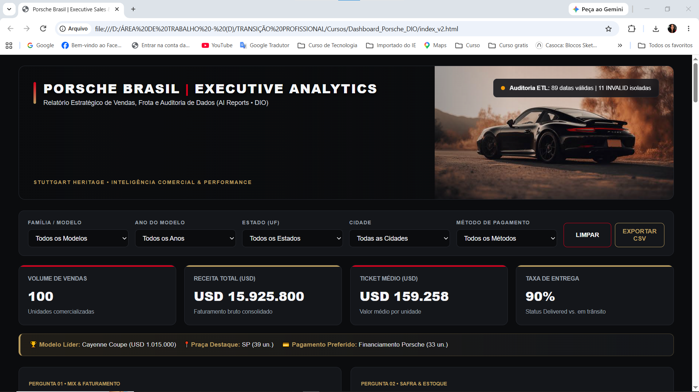
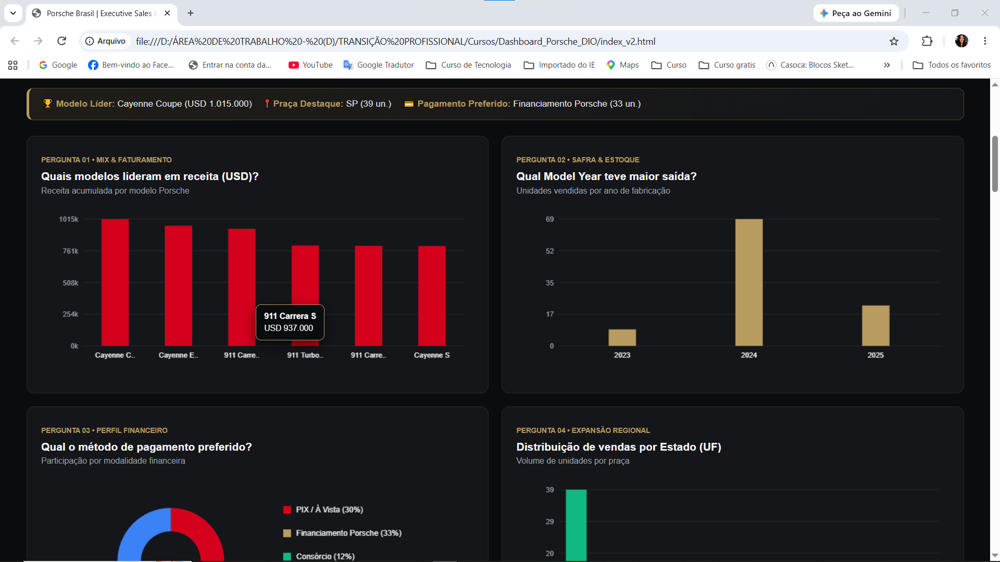
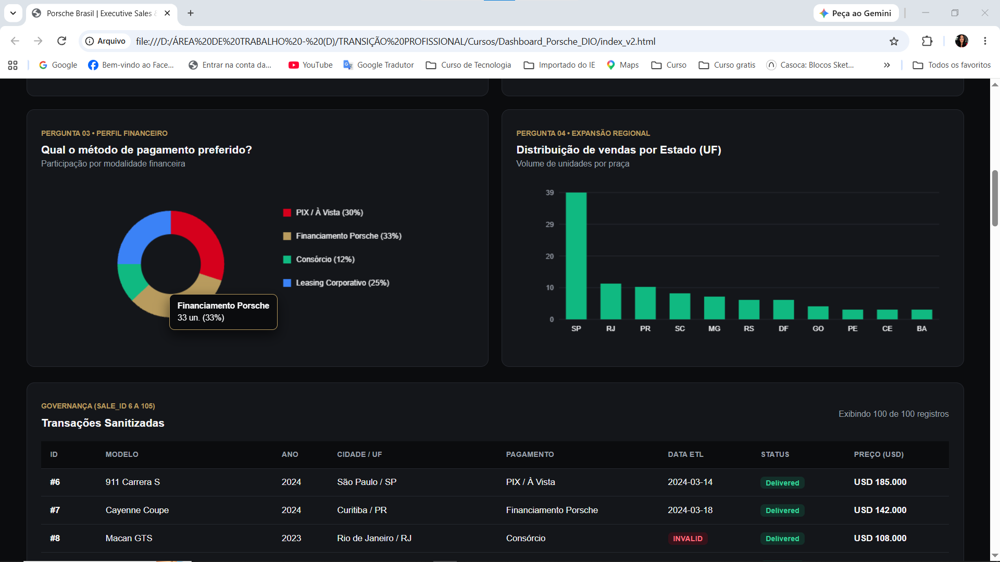
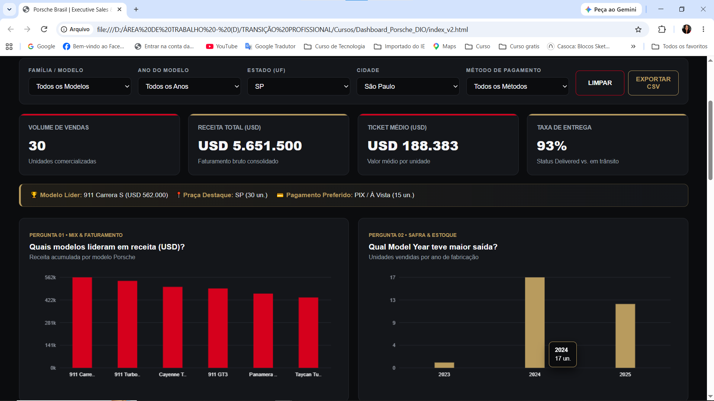

# 🏎️ Porsche Brasil | Executive Sales & AI Report Dashboard

Dashboard executivo interativo desenvolvido como projeto prático da aceleração **Criando Agentes de IA / AI Reports (DIO)**, transformando uma base de 100 registros de vendas da Porsche em uma aplicação web responsiva de arquivo único (`index.html`), com filtros em cascata, insights automáticos, exportação CSV e auditoria de dados.

🔗 **Acesse o Dashboard Online (GitHub Pages):** [Clique aqui para visualizar](https://claudiaalves-tech.github.io/porsche-sales-dashboard/)

---

## 🎯 Perguntas de Negócio Respondidas
1. **Mix & Faturamento:** Quais modelos lideram em receita acumulada (`USD`)?
2. **Safra & Giro de Estoque:** Qual ano de modelo (*Model Year*) teve maior volume de saída?
3. **Perfil Financeiro:** Qual o método de pagamento preferido pelos clientes?
4. **Expansão Regional:** Como as vendas estão distribuídas por Estado (UF)?

## 🧹 Tratamento da Base e Linhagem de Dados (ETL)
* **Localização e Adaptação Regional (Brasil):** A base original foi localizada e adaptada para o contexto comercial da **Porsche Brasil** (14 praças e 11 estados brasileiros), mantendo a padronização financeira internacional em dólar (`USD`). O dataset tratado encontra-se disponível em [`data/porsche_brasil_sanitized_data.csv`](data/porsche_brasil_sanitized_data.csv) para total rastreabilidade.
* **Isolamento de Anomalias:** Identificação e sinalização visual das 11 datas marcadas como `INVALID` no badge de **Auditoria ETL** do cabeçalho e na tabela de governança (`sale_id` 6 a 105).
* **Privacidade:** Remoção de colunas sensíveis, mantendo apenas os atributos analíticos necessários.

## 🤖 Processo de Criação com IA
* **Engenharia de Prompt Iterativa:** Construção guiada com assistente de IA para estruturação do HTML5, estilização Dark Mode inspirada na identidade visual Porsche (`#0B0C0E`, `#D5001C` e `#B89B5E`) e renderização nativa de gráficos em `<canvas>` com tooltips interativos, sem dependência de bibliotecas externas.
* **Funcionalidades Executivas:** Filtros combinados com cascata inteligente (`Estado -> Cidade`), barra dinâmica de insights executivos e botão para exportação instantânea dos dados filtrados em `.csv`.

## 📸 Evidências do Projeto

### 1. Visão Geral e KPIs Consolidados (100 registros)

### 2. Análise de Receita por Modelo e Giro por Safra (Tooltips Interativos)

### 3. Perfil Financeiro, Expansão Regional e Governança ETL

### 4. Filtro Dinâmico Aplicado (Estado: SP • Cidade: São Paulo)

---
Desenvolvido por **Claudia Regina Alves** • Desafio de Projeto DIO
